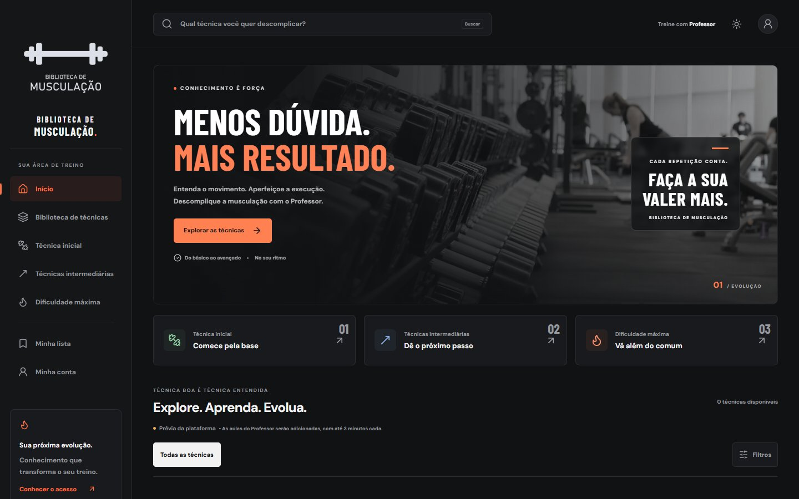
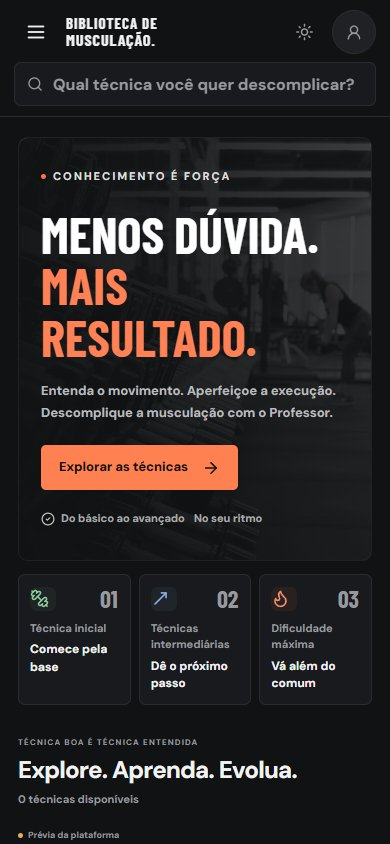

<div align="center">

# 🏋️ Biblioteca de Musculação

**Plataforma de vídeos curtos de musculação com área do aluno, assinatura e painel administrativo.**




</div>

## O que é

Uma plataforma para um professor de musculação publicar aulas curtas (até 3 minutos) explicando exercícios, técnicas e metodologias, do iniciante ao avançado. Os alunos acessam por assinatura paga ou por matrícula gratuita liberada pelo professor.

> Projeto desenvolvido sob encomenda. Nome, marca e contatos do cliente foram substituídos por dados genéricos nesta versão pública.

## Funcionalidades

| Área | O que faz |
|---|---|
| **Biblioteca** | Vídeos organizados por nível (inicial, intermediário, avançado), grupo muscular, metodologia e equipamento, com busca e filtros |
| **Aluno** | Conta própria, lista de técnicas favoritas e situação do acesso |
| **Acesso** | Assinatura paga (Mercado Pago) ou matrícula gratuita concedida pelo professor |
| **Vídeos** | Streaming protegido (Bunny Stream) com upload retomável (tus) |
| **Administração** | Painel de vídeos, alunos e categorias, com login em dois fatores (MFA) |
| **SEO** | Páginas públicas com metadados, sitemap, robots e dados estruturados; páginas privadas fora do índice |
| **Acessibilidade** | Navegação por teclado, contraste verificado e tema claro e escuro |



## Tecnologias

- **Frontend:** React 19 + TypeScript + Vite
- **Backend:** Cloudflare Workers (API e renderização inicial das páginas)
- **Banco e autenticação:** Supabase (Postgres com migrações versionadas)
- **Pagamentos:** Mercado Pago, com webhook assinado
- **Vídeo:** Bunny Stream
- **Testes:** Node test runner (API, banco com PGlite, catálogo e SEO) e Playwright (navegador e acessibilidade)

## Rodar localmente

```bash
npm ci
npm test          # 72 testes
npm run typecheck
npm run build
npm run preview   # http://127.0.0.1:8787
```

A prévia local roda sem nenhuma credencial. Para integrar com Supabase, Bunny e Mercado Pago, copie `.env.example` para `.dev.vars` e preencha os valores (veja `server/README.md`). Chaves privilegiadas ficam só no servidor, nunca em variáveis `VITE_*`.

## Licença

Distribuído sob a [Licença Apache 2.0](LICENSE).

Copyright 2026 Ricardo Barnet Ghisio
